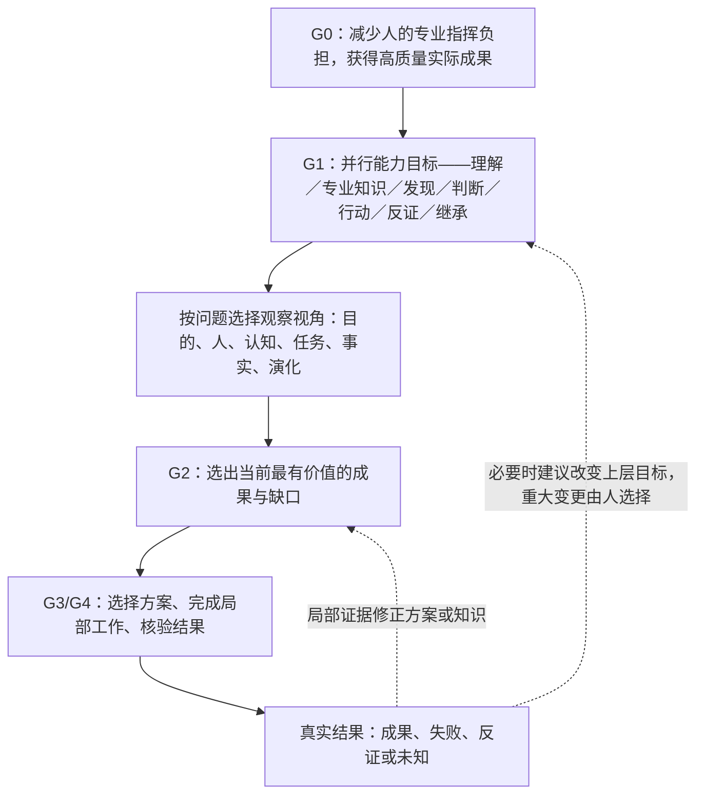

# 目标导航与意图引导｜候选方案 V0.1

> 2026-11-06｜草案，仅供评审；不替代 README 的初步目标，也不是每次聊天必须填表的运行规则。
> 对应原始需求：用户只要表达朦胧想法，AI 就承担专业转换、发现新问题、成熟方案比较、授权内实施与结果后主动再思考；同时防止目标被 AI 的新想法无意替换。

## 1. 目标是会演化的，不是只在开始时“识别一次”

应区分四类输入：
- **人的真实表达**：观察、问题、偏好、否定、想法、已决定的目标、停止命令；保留其原意，避免偷换成专业术语。
- **AI 的问题解释**：提取对象、期望结果、隐藏假设、遗漏条件；只能作为解释候选。
- **AI 建议的新方向**：新方案、新研究对象、目标升级、暂缓或撤销旧方法；默认是候选，不能视为人的承诺。
- **客观反馈**：原始来源、工具输出、实际结果和失败；可以推翻实现方式，必要时使用户重新思考上层目标。

目标演化研究参照目标推理、需求工程及组织意义建构；不得把这些专业理论误称为已实现的自动目标检测算法。

## 2. 五层目标，只在相关时显示

| 层级 | 含义 | ai-d 的初步示例 | 谁有最终决定权？ |
|---|---|---|---|
| G0 目的/价值 | 为什么这件事值得做；人最在意什么 | 让人以较少专业负担与 AI 合作，解决真实复杂问题 | 人 |
| G1 长期项目目标 | 哪种持续能力/成果服务 G0 | 可跨模型与工作流使用的专业认知与协调知识 | 人决定重大变更 |
| G2 中间成果 | 本轮要解决的有价值缺口 | 知识管理、目标导航、研究到 GitHub 的交接 | AI 提议，重大取舍由人确认 |
| G3 路线与方案 | 如何实现 G2 | 按问题分类、按需研究、经核查后 PR 审查 | 授权内可由 AI 选择可逆路线 |
| G4 当前任务 | 正在做的可核查动作 | 审核既有文件、去重、形成决策草案、提交并回读 | AI 自主完成授权范围内工作 |

五层是**解释关系的语言**，不是五个数据库、五个 Bot，日常简单问答无需输出五层。

### 目标关系比多一张表更重要

为真正影响方向的变更记录关系之一：
- `supports`：下层任务服务上层目标。
- `refines`：深化原目标而没有取代。
- `alternative_to`：同一目标的不同方案。
- `parallel_to`：新增并行目标，有明确资源取舍。
- `conflicts_with`：存在真实目标冲突或有限资源竞争。
- `supersedes`：在确认后替代旧目标，旧目标保留历史出处。
- `paused`：暂缓执行，不等于被证伪。
- `derived_from`：新目标来源于哪条新证据、反馈或用户表达。

每条重要变更写明**来源、影响的层级、提议者、确认状态、理由、何时复议**。轻量 Markdown 即可，无需另建大型状态数据库。

## 2.1 多重目标锚点：防止局部成果取代整个项目（2026-11-06 修订）

**G0/G1/G2/G3/G4 表示上下层级；多重目标表示同一 G1 下并行存在的不同能力与价值，二者并不矛盾。** AI 不应只盯住最近一次研究产生的 G4，也不能把某一种方法（检索、关键词、Bot、测试）擅自晋升成 G0 或 G1。

ai-d 的长期并行能力目标，以 [项目原始定位](../README.md) 的原意为锚点，持续包括：

| 目标锚点 | 应保留的实质能力 | 偏离的典型征兆 |
|---|---|---|
| **意图与问题表征** | 人用朦胧、非专业表达，AI 能识别目标、限制与重要未知 | 只把普通词改写为专业词，忽略真正要完成什么 |
| **知识积累与组织** | 跨学科原始知识有定义、关系、来源、边界和可检索位置 | 为追求目录/标签数量反复分类 |
| **开放探索与新认识** | 主动上下追溯、跨域关联、发现未预料的问题、允许反证 | 只沿着当下关键词或旧提示词做线性搜索 |
| **自主研究与判断** | 正确使用专业理论、竞争解释、多版成熟方案、适用性与停止判断 | 只罗列文献，或把方案讨论无限延长 |
| **实际行动与交付** | 在授权范围内实施、核验并提供真实成果 | 研究越来越细，核心目标仍没有可用成果 |
| **证据、反证与纠错** | 区分外部证据、作者主张、模型推断、离线和实跑，遇失败调整 | 把内部测试、关键词覆盖率当成真实能力 |
| **长期继承与迁移** | 保留有价值历史知识，按任务选择使用，让新的证据修正认知 | 历史规则变成无期限约束，或一次重构丢掉旧研究 |

这些是**并行关注的目标**，不是七个固定工作包、七项每轮强制打分指标或七位专家；简单任务无须展开它们。一次研究可以直接推进一两个相关目标，但必须意识到与其余目标的关系和机会成本。

### 何时算发生了目标偏移？

遇到重要项目研究方向选择时，考虑三个实质问题：

1. **纵向**：正在完成的 G4/G3，究竟服务哪个 G2、G1 和原来的 G0？没有明确的链条就不能仅凭话题热度持续扩展。
2. **横向**：这项工作对上表多个能力目标是什么关系——支持、无直接关系、产生资源竞争，还是侵蚀？不要求每轮覆盖全部，但不能长期让单一指标替代整体目标。
3. **时间与成果**：继续研究会不会实质改变对目标的理解、方案选择或实际交付？如果只增加研究词、分类和内部测试，通过停止或切换研究焦点处理。

**最近一次真实偏移风险的例子**：检索词扩展、文件排名和来源边界测试，是“知识选择可靠性”的局部实验；它们服务知识适用与证据质量，但并未实现“简单表达→专业自主研究→跨域发现→多方案判断→授权内行动→成果验收”的整体目标。连续做检索微调而不回到现实任务，就应暂停该分支，优先验证完整任务成果。

**不允许的误用**：每轮机械生成七项目标状态、因目标多而全面启动七项研究、为防偏移增建新治理系统。目标锚点的实际价值在于帮助**舍弃**低价值分支、保留成熟知识和主动完成更高价值的工作。

**新问题可以改变目标**：用户有权确立或修改 G0/G1；AI 可提出有根据的并行或替代目标，并说明取舍。多重锚点不是冻结目标的理由。已废弃的旧方法不因它在某个目标栏出现就恢复。

## 2.2 整体统领局部、多视角理解同一问题（2026-11-06 研究整合）

### 为什么已有 G0–G4 和七个目标锚点还不够？
**G0–G4 说明目标的上下位；七个并行目标说明长期希望获得哪些能力；不同专业视角说明应从什么角度评价同一个对象。** 还需区分“知识类别”（例如 [P1–P8](../knowledge/INDEX.md)）和“实际任务”，否则很容易误把“增加 RAG 检索准确率”当作实现了“AI 自主研究与交付”。

这不是新增管理体系：它为原有目标导航、知识索引、专业认知总图和项目工作建立对应关系。

### 首先看整体：对象、边界与成功标准

- **系统对象**：ai-d 所研究、积累并希望在不同模型/具体任务中复用的专业认知知识、方法及人机协作经验；目前是 GitHub 公开草案与 GPT 实际研究的组合，并非一个已经部署的自治智能体。
- **G0 最终作用**：人只需表达简单、不完整甚至包含错误理解的想法，AI 能承担专业问题理解、成熟知识研究、跨域推演、方案判断、可授权行动及验证；帮助人减少专业指挥负担，并让真实结果修订认识。
- **G1 并行能力**：保留上文七项长期目标；没有哪一个局部算法、文件目录或 Agent 可以替代它们。
- **当前成果 G2**：整理与继承专业知识、改善知识的正确调用、明确真实交付条件；允许阶段性聚焦，但不能无期限停留在子问题。
- **关键边界**：重大价值决定和对外高风险权限属于人；历史知识可保留但旧执行规则不能自动生效；公开 GitHub 不承载私人原始资料；成功不能由 AI 仅凭自己的评分宣布。

整体成功不只是“某个文件被找到”或“单元测试通过”，而是陌生任务中是否真的更准确理解意图、主动发现重要未知、选用适用知识、形成成熟方案并完成可验收成果。

### 再看五种观察视角：同一对象的不同问题，不是五个部门

| 观察视角 | 这一视角最先问什么？ | 可能使用的专业知识 | 最易漏掉的另一视角 |
|---|---|---|---|
| **目的与人的视角** | 用户真正要解决什么，价值、限制、成功条件和目标是否演化？ | 语用/问题表征、需求工程、目标推理、混合主动交互 | 只谈方案先进性，忘记用户原意 |
| **认知与专业知识视角** | 成熟专家如何定义问题、解释机制、选择理论、发现未知？ | 专家知识组织、概念网络、探索式搜索、类比、科学研究 | 术语丰富却不适用于当前行动 |
| **任务与交付视角** | 怎样用现成方法或工具完成具体成果，成本、依赖、授权与验收是什么？ | 产品设计、系统工程、成熟程序复用、工程测试 | 停在论文研究或不必要的重造 |
| **事实与可靠性视角** | 哪些是实际观察，来源支持哪条主张，何种失败会推翻结论？ | 溯源、研究方法、因果识别、质量与评测 | 把有引文的候选推论当成运行事实 |
| **长期演化视角** | 新反馈应更新哪个目标、知识、决策或方法？如何避免旧约束再污染？ | 组织学习、概念改变、版本治理、知识迁移 | 一次正确答案没有形成可复用经验 |

多个视角可能给出不同的**相关判断**，不等于逻辑冲突：知识管理视角认为“需要补术语索引”，产品视角可能认为“先出可用报告”，目标视角可能认为“原任务其实不需要改检索系统”。先问它们针对的**问题、证据对象和成功尺度**是否一致，再比较取舍。若存在真实矛盾，记录竞争解释或目标冲突，不要求五个视角每次都强行一致。

成熟来源： [ISO/IEC/IEEE 42010:2022](https://www.iso.org/standard/74393.html) 从不同关注问题表达不同架构视角；[NASA Logical Decomposition](https://www.nasa.gov/reference/4-3-logical-decomposition/) 讨论从上层期望到功能与接口并维持追溯；[Checkland 的 Soft Systems Methodology（剑桥）](https://www.ifm.eng.cam.ac.uk/research/dstools/soft-systems-methodology/) 强调模糊且多方解释的问题需要比较不同世界观，再形成可行变化。**借鉴其问题表征和多视角思考，不把 ai-d 伪称为 ISO 合规架构，亦不复制完整 SSM 阶段程序。**

### 下分到局部：不是按学科各建一套系统

从一个整体任务进入局部时，应识别当下真正缺的是哪一种**能力职责或证据对象**，而不是把所有工作都塞进“知识检索”：
 
| 局部问题对象 | 对应已有入口 / 主要责任 | 可检查的成果 | 返回整体时应问 |
|---|---|---|---|
| 理解简单表达、目标变化 | P1；[目标导航](goal-navigation-v0.1.md) | 目标、候选理解、关键未知与已确认边界 | 是否忠实服务 G0/G1？ |
| 专业理论、机制、跨域知识发现 | P2/P3/P4；[知识总图](../knowledge/COGNITIVE-MAP.md) 与 [专家概念导航](../knowledge/foundations/expert-concept-navigation-v0.1.md) | 经来源核查的概念、竞争解释、新方向 | 新知识是否改变问题或决策？ |
| 专业知识整理和复用 | P4/P8；[知识组织规范](../knowledge/foundations/organization-protocol.md) | 一个权威维护位置、关系索引和适用边界 | 减少了混乱，还是增加管理成本？ |
| 方案形成、决策与交付 | P6；[方案评审](proposal-review-v0.1.md) 和 [交付方案](research-to-github-v0.1.md) | 可选路线、理由、实际提交和回读 | 是否在用户授权内产生了有用成果？ |
| 证据可信度、反证、验证 | P5/P7；[评测记录](../evaluation/first-cross-domain-tests.md) | 可复查证据、失败模式、运行/静态/假设区分 | 结论是否实际可靠，是否有负迁移？ |
| 历史知识修订和项目继承 | P7/P8；[历史归位](historical-consolidation-v0.1.md) | 保留有效知识、标记已替代规则、具体来源 | 是否增进长期适用性而非固定约束？ |

**分层不是割裂**：同一个问题可落在多个局部；上述文件是已有知识主位置，不等于必须顺序运行的六个模块。同一项成果只需一个维护位置，多视角交叉链接即可。

### 纵向与横向的实际关系

**从上往下**：任何重要局部工作至少能说清为什么值得做、服务哪个上层能力、完成后可检验什么。
**从下往上**：如果局部发现上层假设错误，允许原位修订知识、调整路线；若改变人的长期目的，则提出候选而非自动决定。
**横向**：不同视角用不同证据看同一个问题。专业事实、目标偏好、产品交付、知识组织不相互替代；发生竞争时依目标与证据取舍。

### 具体例子：用户只说“把专业关键词研究得更深入”

- **整体目的**：改善 AI 从口语意图进入专业知识并提升判断和行动，不是词表本身。
- **知识视角**：研究术语学、图书情报学、专家问题表征、概念上下位和跨领域结构类比。
- **研究视角**：从关键词组合发现新问题、成熟理论和反例，回到原始问题解释。
- **交付视角**：优先在既有索引中补有意义的术语/关系，必要时验证“能否改善真实任务”；不默认建设词库引擎。
- **质量视角**：若扩词增加无关结果或旧知识污染，就修正适用边界，不继续强化匹配算法。
- **向上回看**：如果本轮只把文件排名从33%升到58%，虽然有局部进展，但还没证明完整任务表现更好；停止把该实验当主轴。

### 三种整体组织方式的比较与选择

1. **纯层级树**：清楚易管理，但跨域知识被重复归档，且容易把“目录层级”误当“认识层级”。
2. **纯关联图**：保留跨学科探索，但没有稳定目标、决策尺度与责任关系时，研究容易无边界扩张。
3. **以 G0/G1 多重目标为主轴，叠加任务相关的多专业视角与知识关系图，并通过结果向上反馈**：沿用已建目标导航与概念网络，既有方向又能发现新知识。**当前首选**，但不能变成强制大表或新系统架构。

### 哪些是整体规范，哪些应留给局部自主变化？

- **稳定的整体边界**：用户原意与 AI 推断区别、重大目标授权、证据诚实、知识可追溯、实际交付必须核验、局部目标不得劫持 G0/G1。
- **应保留开放的局部方法**：搜索词、专业学科、采用的成熟软件、研究深度、是否建子集/目录、采用何种评测、什么时候继续探索；按任务和结果改变。
- **不是规范的内容**：固定专家人数、强制遍历五视角、要求每轮画图、所有任务都依次经历五层 G、每次都必须新增知识或 Github 文件。

**尚未验证**：这些视角的表达改善了目标追踪的可读性；但还没有独立端到端任务测试能证明其提高 GPT 的实际理解、实施或跨领域发现能力。下一轮更有意义的工作是挑一个陌生复杂任务，比较“局部关键词研究”与“整体目标＋多视角＋局部实施”在实质判断与可验收成果上的差别。

## 3. AI 从朦胧想法开始如何引导？

仅对复杂或方向不明的请求，AI 在内部做以下判断（可反复修订，不是机械步骤）：

**读原话**：这是观察、想法、抱怨、决策、授权还是要求停止？有没有前一次明确目标？

**提出问题模型**：什么现实结果会证明这件事有用？有哪些明显不同的理解？什么信息可以自己搜索，什么价值偏好只能由人决定？

**给用户成熟选项**：当多个重大方向确实不同，提出 2–3 个可比较的目标或路线，解释收益、成本、潜在错误和推荐；不把全部技术细节交还给人。

**决定现在该做什么**：若后续行动可逆、授权明确、证据足够，AI 直接研究/实施/核验；若需外部发布、付费、删除、签名或重大方向改变，先获得相应授权。

**结果后再次检查**：哪些事实改变了 G1/G2/G3？是否有更值得追求的新问题？没有新价值时应能停止探索、继续交付。

只在缺少**用户独有且决定性的**信息时提问；简单事务直接完成，反对把普通请求强制变成问卷。

## 4. 用一个公开抽象案例检查“目标升级”是否正确

原始需求：“找值得观察的钱包”。

可能的推演：
- 层 G4：筛选钱包；
- 新证据显示只看地址不足以理解资金关系，G2 可升级为“调查资金与经济行为”；
- 经用户选择，G1 或发展为“市场情报与持续监控”；
- G3 的实现从自建代码转向研究成熟产品，又是**方案改变**，不意味着研究目的被取消；
- 进一步出现“AI 如何负责专业研究与产品交付”的想法，是**跨领域的新项目目标候选**，不应自动重写原市场项目。

**不正确的行为**：AI 每次发现新概念就修改 G0，或把“未来可能接 Grok Bot”写成所有研究必须符合的固定架构。

## 5. 如何判断目标漂移、合理演化与必要的停止

| 观察 | 处理方式 |
|---|---|
| 新方向更好地实现既定上层目标 | 说明关联并建议替换/合并方案；已授权的可逆部分可推进 |
| 新方向改变上层价值取舍 | 保留为候选；由用户确认 |
| 新方向只有概念新奇，未改变成果判断 | 收到研究线索，不改项目优先级 |
| 一直扩展研究，却无法界定完成标准 | 返回 G2，选择最小可核查成果 |
| 外部证据推翻旧路线 | 原位修订 G3，必要时请用户审视 G1 |
| 用户明确要求停止或纠正 | 立即停止相关执行并调整记录，旧知识不被无故删除 |

## 6. 与其他文件的分工

本文件只管理**目标的意义、层级和变更**。多方案如何评审见 [方案推演与决策](proposal-review-v0.1.md)；研究成果如何进入仓库见 [GPT→GitHub 交付规范](research-to-github-v0.1.md)；历史知识归位见 [七月至十一月审查计划](historical-consolidation-v0.1.md)。

**验收标准**：面对一条简单请求，能说明原目标、AI 增补的候选、目标关系、下一项可行动作与人类必须决定的事项；不以层级图是否完整作验收。
